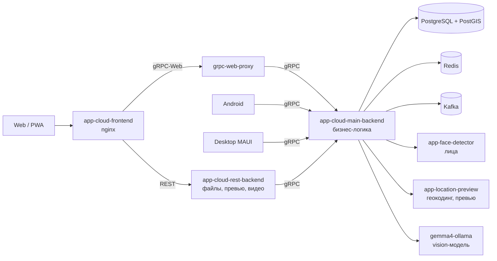

# SmartBerryStorage

Рабочее пространство SmartCloud — платформы для хранения файлов, фото и видео на собственном сервере:
лента медиа, альбомы, распознавание лиц, карта снимков и AI-описания.

Этот репозиторий объединяет проекты только на уровне файловой системы и хранит общие для них материалы.
Код каждого компонента живёт в собственном git-репозитории, а вложенные папки исключены через `.gitignore`.

## Состав

Имя папки каждого проекта совпадает с именем его репозитория.

| Папка и репозиторий | Что это | Стек |
| --- | --- | --- |
| [SmartCloud-Backend-apps](https://github.com/Bati4eli/SmartCloud-Backend-apps) | Сервер: gRPC и REST API, обработка медиа, развёртывание | Java, Groovy, Python, Gradle, PostgreSQL/PostGIS, Kafka, Redis |
| [SmartCloud-Android](https://github.com/Bati4eli/SmartCloud-Android) | Android-клиент | Java, gRPC |
| [SmartCloud-Frontend](https://github.com/Bati4eli/SmartCloud-Frontend) | Web-клиент, устанавливается как PWA | Angular 21, Material 3, gRPC-Web |
| [SmartCloud-Desktop-MAUI](https://github.com/Bati4eli/SmartCloud-Desktop-MAUI) | Кроссплатформенный клиент, ранняя стадия | .NET 8 MAUI, gRPC |

## Установка

Проекты должны лежать рядом внутри этого репозитория: `docker-compose.yml` и `npm run gen:proto`
находят соседние папки по относительным путям.

```bash
git clone https://github.com/Bati4eli/SmartBerryStorage-all-in-one.git
cd SmartBerryStorage-all-in-one

git clone https://github.com/Bati4eli/SmartCloud-Backend-apps.git
git clone https://github.com/Bati4eli/SmartCloud-Android.git
git clone https://github.com/Bati4eli/SmartCloud-Frontend.git
git clone https://github.com/Bati4eli/SmartCloud-Desktop-MAUI.git
```

## Архитектура



Контракты API описаны в `.proto`-файлах модуля `SmartCloud-Backend-apps/Common-gRPC`.

## Запуск

Полный стек поднимается через Docker Compose из `SmartCloud-Backend-apps/CI-CD-local`:

```bash
docker compose up -d --build
```

Web-клиент откроется на <http://localhost>. Перед первым запуском:

1. Замените в `docker-compose.yml` пути вида `/E/MY_CLOUD_STORAGE/**` на свои каталоги.
2. Подготовьте модели для контейнера `gemma4-ollama`. Он использует NVIDIA GPU и выполняет AI-обработку изображений.

Сервисы `app-ai-descriptor` и `app-nude-detector` сейчас отключены в Compose и оставлены для отката.

Для разработки web-клиента достаточно запущенного backend:

```bash
cd SmartCloud-Frontend
npm install
npm start
```

Dev-сервер откроется на <http://localhost:4200>.

Подробнее о каждом компоненте:

- [Backend](https://github.com/Bati4eli/SmartCloud-Backend-apps#readme) и [авторизация](https://github.com/Bati4eli/SmartCloud-Backend-apps/blob/main/README-auth.md)
- [Android-клиент](https://github.com/Bati4eli/SmartCloud-Android#readme) и [синхронизация](https://github.com/Bati4eli/SmartCloud-Android/blob/main/README-sync.md)
- [Web-клиент](https://github.com/Bati4eli/SmartCloud-Frontend#readme) и [план переноса функций](https://github.com/Bati4eli/SmartCloud-Frontend/blob/main/ROADMAP.md)
- [Desktop MAUI](https://github.com/Bati4eli/SmartCloud-Desktop-MAUI#readme)

## Разработка

Git-команды выполняются отдельно в папке того репозитория, который меняется.

**Изменение контракта.** После правки `.proto` в `SmartCloud-Backend-apps/Common-gRPC/src/main/proto`:

1. Перегенерируйте TS-клиенты: `npm run gen:proto` в `SmartCloud-Frontend`.
2. Скопируйте изменённые файлы в `SmartCloud-Android/Common-gRPC/src/main/proto`.

**Изменение интерфейса.** Экраны, тексты и переходы держим одинаковыми в Web и Android.
Отличаться могут только платформенные детали: жесты и системные диалоги.

Проект MAUI в эти процессы пока не включён: у него своя копия контрактов в `Protos`.

## Содержимое этого репозитория

| Путь | Назначение |
| --- | --- |
| [`specs/`](specs) | Спецификации функций |
| [`.specify/`](.specify) | Шаблоны и скрипты Spec Kit |
| [`AGENTS.md`](AGENTS.md), [`CLAUDE.md`](CLAUDE.md) | Правила работы AI-агентов в рабочем пространстве |
| `.claude/`, `.codex/` | Настройки и навыки AI-агентов |
| `explain_*.sql` | Запросы для анализа производительности SQL |
