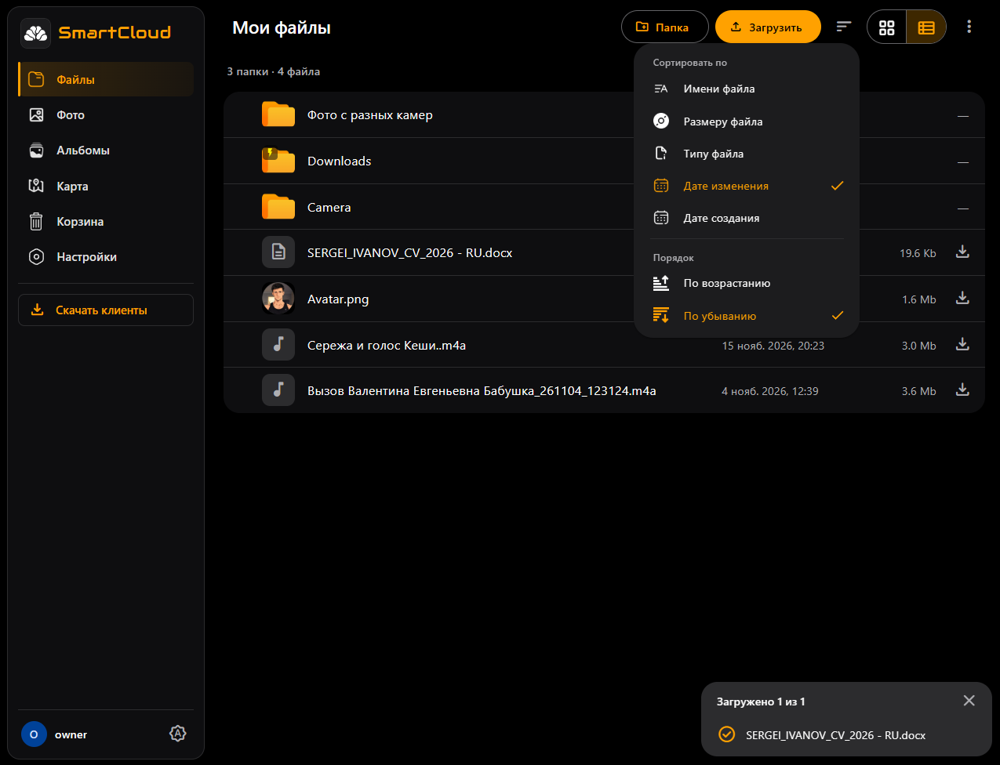
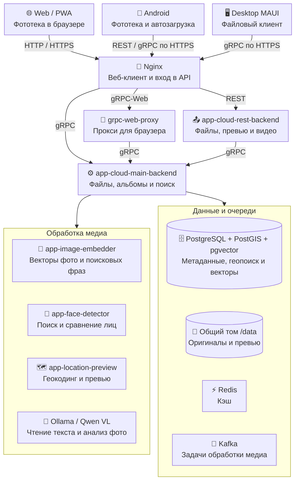

### Облачное хранилище фото и видео. Новые снимки с Android загружаются автоматически, а фототека доступна на телефоне и в браузере.

- 👥 **Люди и категории.** ИИ находит лица и группирует снимки одного человека. По категориям, которые определил ИИ, легко найти фото природы или кадры из поездок.
- 🔎 **Умный поиск.** Напишите «закат у моря», и векторный поиск подберёт фото по смыслу запроса.
- 🗺️ **Карта, теги и динамические альбомы.** На карте видно, где сделаны снимки. Теги помогают создать подборки, а динамические альбомы сами пополняются фотографиями из выбранных папок.
- 🔗 **Альбомы по ссылке.** Отправьте ссылку на альбом друзьям или семье.
- 👁️ **Скрытие чувствительных снимков.** Приложение автоматически определяет и скрывает чувствительные фото, чтобы можно было спокойно показать друзьям кадры из отпуска.



## 🏗️ Архитектура



`app-image-embedder` использует `jina-clip-v2`, чтобы представить превью и поисковый запрос в одном векторном пространстве. Векторы фотографий хранятся в PostgreSQL, где `pgvector` находит ближайшие совпадения. Оригиналы и превью доступны серверу и сервисам обработки в общем томе `/data`.

## 📦 Репозитории

| Репозиторий | Назначение | Стек |
| --- | --- | --- |
| [SmartCloud-Backend-apps](https://github.com/Bati4eli/SmartCloud-Backend-apps) | Сервер, обработка медиа и развёртывание | Java, Groovy, Python, gRPC, PostgreSQL |
| [SmartCloud-Android](https://github.com/Bati4eli/SmartCloud-Android) | Android-клиент с автозагрузкой | Java, gRPC |
| [SmartCloud-Frontend](https://github.com/Bati4eli/SmartCloud-Frontend) | Веб-клиент с установкой как PWA | Angular, Material 3, gRPC-Web |
| [SmartCloud-Desktop-MAUI](https://github.com/Bati4eli/SmartCloud-Desktop-MAUI) | Кроссплатформенный клиент на раннем этапе разработки | .NET MAUI, gRPC |

## 🚀 Локальный запуск

Расположите исходники бэкенда и веб-клиента в соседних каталогах.

```bash
git clone https://github.com/Bati4eli/SmartCloud-Backend-apps.git
git clone https://github.com/Bati4eli/SmartCloud-Frontend.git
```

<a name="модели-для-обработки-фото"></a>

### ✨ Модели для обработки фото

| Модель | Назначение | Оборудование |
| --- | --- | --- |
| [InsightFace buffalo_l](https://pypi.org/project/insightface/0.7.3/) | Детекция лиц | CPU |
| [jina-clip-v2](https://huggingface.co/jinaai/jina-clip-v2) | Эмбеддинги фото и запросов для поиска по смыслу | NVIDIA GPU, ≈1,8 ГБ VRAM |
| [Qwen2.5-VL 3B Instruct Q4_K_M](https://huggingface.co/ggml-org/Qwen2.5-VL-3B-Instruct-GGUF) | Чтение текста на фото и определение чувствительного контента | **8 ГБ VRAM**, например RTX 3070 Ti |
| [Qwen3-VL 8B Instruct Q4_K_M](https://huggingface.co/Qwen/Qwen3-VL-8B-Instruct-GGUF) | Чтение текста на фото и определение чувствительного контента | **16 ГБ VRAM**, например RTX 5070 Ti |

### 🐳 Запуск сервисов

Из каталога с исходниками бэкенда и веб-клиента соберите серверные JAR-файлы с JDK 17 и запустите стек фототеки. Для сборки нужен интернет, для запуска — доступ Docker к NVIDIA GPU.

```powershell
cd SmartCloud-Backend-apps
.\gradlew.bat :AppMainModule:bootJar :AppRestFileManager:bootJar
cd CI-CD-local
docker compose -f docker-compose.yml up -d --build app-cloud-frontend `
  app-face-detector app-location-preview app-image-embedder
```

Веб-клиент доступен на <http://localhost>.

Для разработки веб-клиента сначала запустите бэкенд. Следующие команды выполните из родительского каталога обоих репозиториев.

```bash
cd SmartCloud-Frontend
npm install
npm start
```

Dev-сервер откроется на <http://localhost:4200>.

### 📚 Документация компонентов

- [Backend](https://github.com/Bati4eli/SmartCloud-Backend-apps#readme) и [авторизация](https://github.com/Bati4eli/SmartCloud-Backend-apps/blob/main/README-auth.md)
- [Android-клиент](https://github.com/Bati4eli/SmartCloud-Android#readme) и [синхронизация](https://github.com/Bati4eli/SmartCloud-Android/blob/main/README-sync.md)
- [Web-клиент](https://github.com/Bati4eli/SmartCloud-Frontend#readme) и [план переноса функций](https://github.com/Bati4eli/SmartCloud-Frontend/blob/main/ROADMAP.md)
- [Desktop MAUI](https://github.com/Bati4eli/SmartCloud-Desktop-MAUI#readme)

## 🛠️ Разработка

Git-команды выполняются отдельно в папке того репозитория, который меняется.

**Изменение контракта.** При правке `.proto` в `SmartCloud-Backend-apps/Common-gRPC/src/main/proto` обновите контракты клиентов.

1. Выполните `npm run gen:proto` в `SmartCloud-Frontend`, чтобы перегенерировать TS-клиенты.
2. Скопируйте изменённые файлы в `SmartCloud-Android/Common-gRPC/src/main/proto`.

**Изменение интерфейса.** Экраны, тексты и переходы держим одинаковыми в Web и Android.
Отличаться могут только платформенные детали: жесты и системные диалоги.

Desktop MAUI хранит свою копию контрактов в `Protos`.
